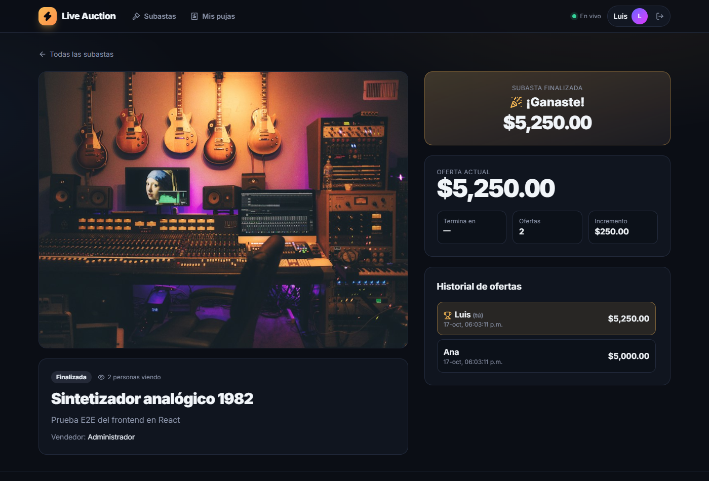
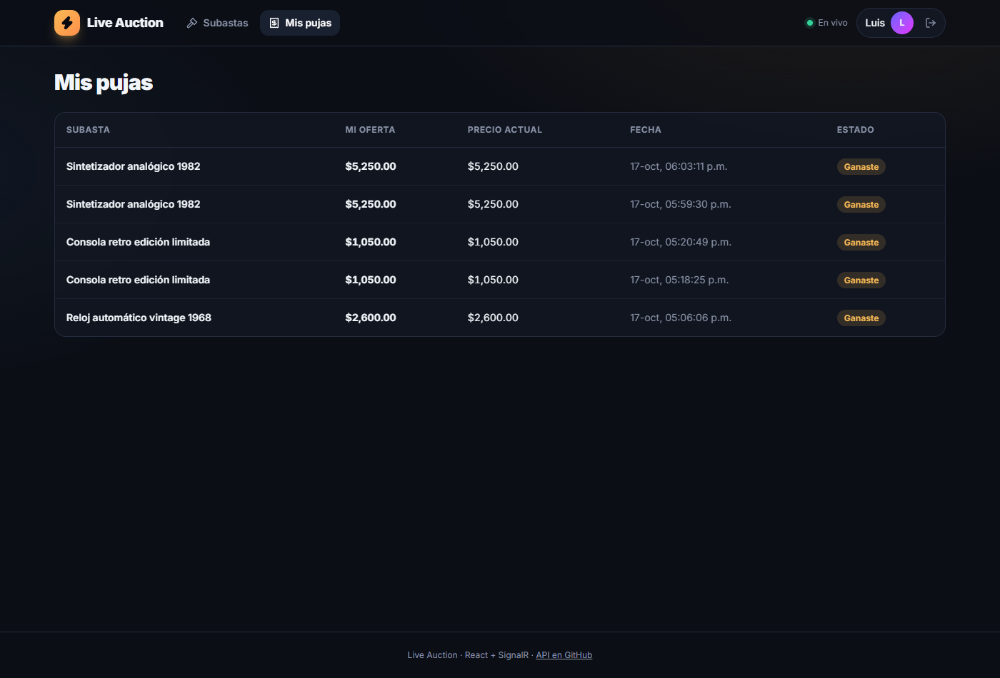
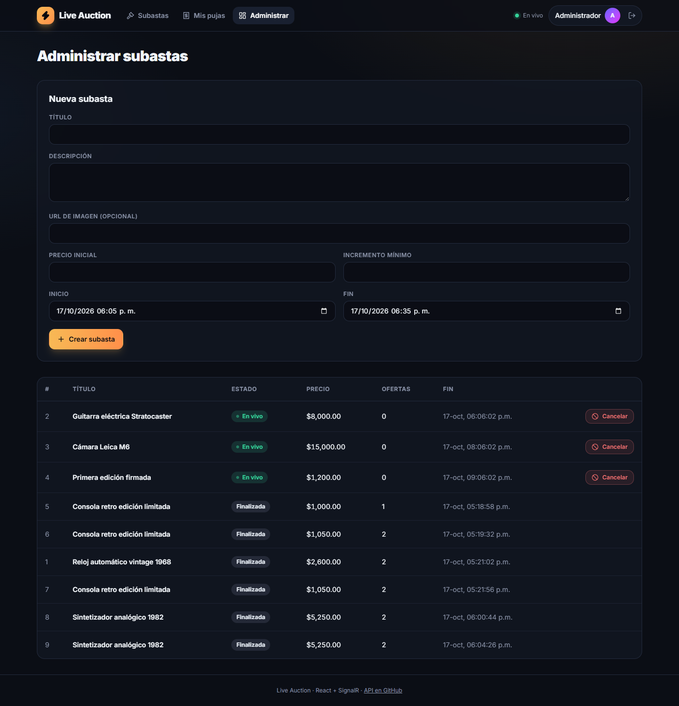
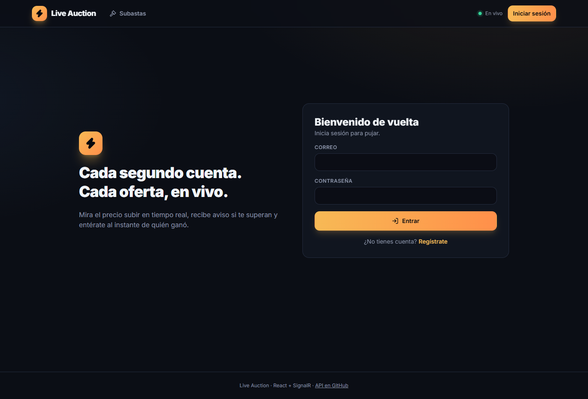

# ⚡ Live Auction · Web

[](https://github.com/edu-tech220/live-auction-web/actions/workflows/ci.yml)


Frontend for **Live Auction**, a real-time auction platform. Prices, bids, viewer counts and the
final result arrive live through **SignalR**, without reloading the page.

API and business logic: **[edu-tech220/live-auction](https://github.com/edu-tech220/live-auction)** (ASP.NET Core + SignalR + SQL Server).


> The user interface is in Spanish (es-MX); code and documentation are in English.

## Highlights

- **A single SignalR connection** for the whole app (`RealtimeProvider`), recreated on sign-in and
  sign-out so the server always sees the right identity.
- **Live events update the React Query cache**, not a parallel state: REST and SignalR feed the same
  source (`setQueryData` with pure functions from `lib/auctionState.ts`).
- **Out-of-order or duplicated events cannot break the UI.** `bidCount` works as a sequence number,
  so a stale event never "lowers" the price.
- **Reconnection with resynchronization.** After reconnecting, every screen rejoins its group and
  `JoinAuction` returns the current state, recovering whatever happened while offline.
- **No critical business rules in the client.** The browser only sends the amount; the server decides
  whether it is valid, who is winning and when the auction ends. The countdown is corrected with the
  server clock but is purely visual.
- **Private rejections.** If your bid is invalid only you see the reason (`BidRejected` is sent to
  the caller). If someone outbids you, you get a notification.

## Features

| Screen | What it does |
|---|---|
| Catalog | Filters (live, upcoming, finished), search, live prices and bid counts |
| Auction | Animated live price, countdown, suggested amounts, live bid history, viewers and final result |
| My bids | Whether you are winning, were outbid, won or lost |
| Admin | Create and cancel auctions (Admin role only) |
| Sign in / Sign up | JWT session; automatic sign-out when the token expires |

## Tech stack

React 19 · TypeScript (strict) · Vite 8 · React Router · TanStack Query · `@microsoft/signalr` ·
Tailwind CSS 4 · Vitest + Testing Library · oxlint · Docker (Nginx) · GitHub Actions

## Getting started

Requirements: Node 24+ and the [API](https://github.com/edu-tech220/live-auction) running.

```bash
npm install
cp .env.example .env     # VITE_API_URL=http://localhost:5080
npm run dev              # http://localhost:5173
```

> If you run the API with Visual Studio's **https** profile, use `VITE_API_URL=https://localhost:7080`.
> The API already allows the `http://localhost:5173` origin through CORS in development.

With Docker (the API URL is baked in at build time):

```bash
docker build --build-arg VITE_API_URL=http://localhost:5080 -t live-auction-web .
docker run -p 8080:80 live-auction-web   # http://localhost:8080
```

## Scripts

| Command | What it does |
|---|---|
| `npm run dev` | Development server with HMR |
| `npm test` | Tests (Vitest + Testing Library) |
| `npm run typecheck` | Strict TypeScript |
| `npm run lint` | oxlint |
| `npm run build` | Production build into `dist/` |

## Tests

**32 unit and component tests:**

- `lib/auctionState`: applying live events, ignoring duplicated and out-of-order events, never "reviving" a finished auction.
- `lib/api`: sends the JWT and **only the amount**, ProblemDetails → `ApiError` with `code`, a 401 ends the session, network errors.
- `lib/format`: countdown with server clock offset, currency.
- Components: bid panel (suggestions, low amounts are not blocked client-side, seller and signed-out states), final result, auction card.

It was also tested end to end with two real browsers against the API (live bids, caller-only
rejections, "you were outbid" notification, viewers, closing with a winner).

## Project structure

```
src/
  auth/        AuthContext (session, sign-in, expiration) and session storage
  realtime/    RealtimeProvider (SignalR connection) and useAuctionRoom / useLobby hooks
  lib/         API client, contract types, pure state functions, formatting
  components/  Layout, AuctionCard, BidPanel, history, result, UI
  pages/       Home, Auction, Auth, MyBids, Admin
```

## Screenshots

| Catalog | Final result |
|---|---|
|  |  |

| My bids | Admin |
|---|---|
|  |  |

| Sign in | Mobile |
|---|---|
|  |  |

## License

[MIT](LICENSE)
